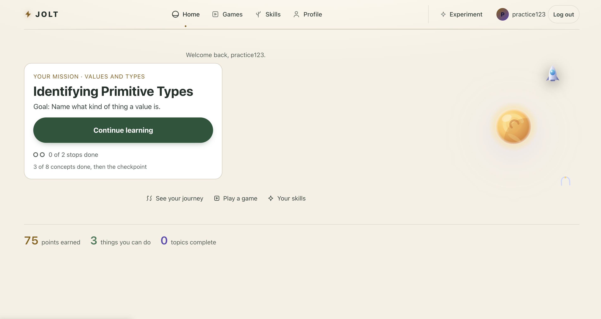
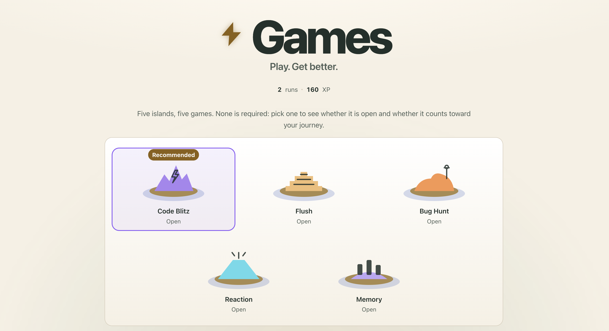
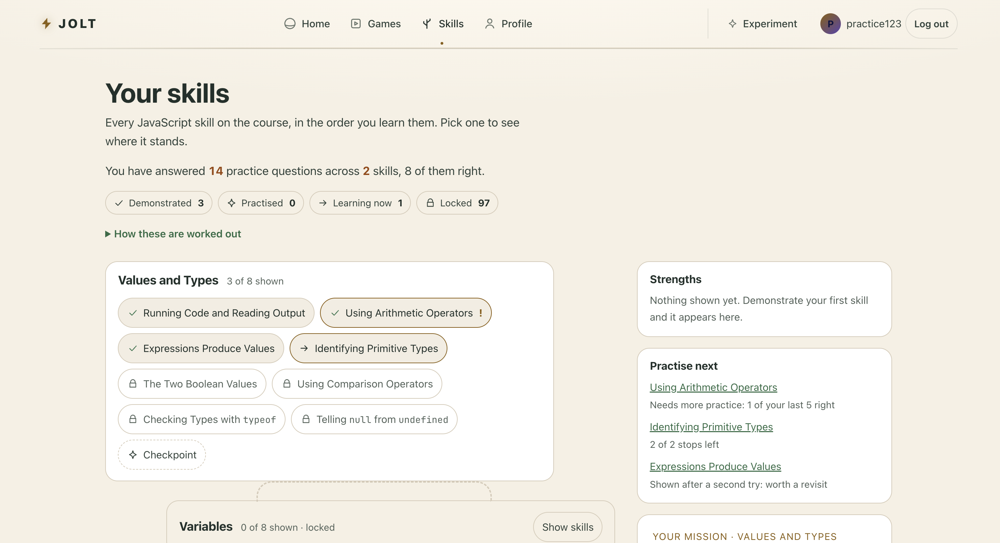

# Jolt

**PLAY. GET BETTER.** Jolt is a full-stack learning platform that turns software engineering practice into short, replayable games. Instead of only reading lessons, learners can practice concepts through interactive challenges and build momentum one round at a time.

<p align="center">
  <a href="https://jolt-4mjc.onrender.com/"><strong>▶ Try the live demo</strong></a>
  &nbsp; · &nbsp;
  <a href="#getting-started">Run locally</a>
</p>

> **Project focus:** Make learning feel like play while giving learners a clearer path from practice to progress.

## Product Screenshots



*Home: the learner's current mission, how many of its stops are done, and a single next step.*



*Games: five islands, five games, with Code Blitz recommended.*



*Skills: every skill on the course with its status, plus what to practise next and why.*

## What you can do

- **Practice through games:** Play Code Blitz, Flush, Reaction, Memory, and Bug Hunt.
- **Learn by doing:** Work through interactive challenges built around software engineering concepts.
- **Create an account:** Use session-based authentication to keep account access and learning activity tied to a learner.
- **Build momentum:** Earn XP and use practice results to understand progress and what to work on next.
- **Practice in a full-stack app:** Experience a React and TypeScript client backed by an Express API and PostgreSQL database.

## Built with

| Area | Technologies |
| --- | --- |
| Frontend | React, TypeScript, Vite, React Router |
| Backend | Node.js, Express, TypeScript |
| Database | PostgreSQL |
| Authentication & sessions | Argon2 password hashing, express-session, connect-pg-simple |
| Validation & testing | Zod, Vitest, Testing Library, Supertest |
| Deployment | Render |

## How it fits together

Jolt is organized as two applications in one repository. The client provides the interactive learning and game experience. The server exposes API routes, handles authentication and game logic, and reads and writes persistent data in PostgreSQL. In production, the Express server serves the built client from the same origin.

```text
Jolt
├── client/   React + TypeScript + Vite UI
└── server/   Express + TypeScript API
             └── PostgreSQL database
```

## Getting started

### Prerequisites

- Node.js 22 or later
- PostgreSQL
- npm

### 1. Clone the repository

```bash
git clone https://github.com/iamtati1/game-night.git
cd game-night
```

### 2. Create a database and configure the server

Create a local PostgreSQL database:

```bash
createdb code_blitz_dev
```

Copy the example environment file:

```bash
cp server/.env.example server/.env
```

Update `server/.env` with your local database connection string and a strong session secret:

```env
DATABASE_URL=postgresql://YOUR_USER@localhost:5432/code_blitz_dev
SESSION_SECRET=replace-with-a-long-random-string
```

The optional `QUIZAPI_KEY` enables the QuizAPI integration. Without it, the game can use question content already stored in PostgreSQL.

### 3. Install dependencies

The client and server have separate package files, so install dependencies in each directory:

```bash
cd server && npm install
cd ../client && npm install
```

### 4. Set up the database

From the repository root:

```bash
cd server
npm run migrate
npm run seed
```

The migration runner records applied migrations and skips those already applied. You can preview pending migrations with:

```bash
npm run migrate -- --dry-run
```

### 5. Run the app

Open two terminal windows from the repository root.

**Terminal 1 — API server**

```bash
cd server
npm run dev
```

**Terminal 2 — Vite client**

```bash
cd client
npm run dev
```

Open the local client URL printed by Vite (typically `http://localhost:5173`). The client development server proxies API requests to the local Express server.

## Run tests

Run the client and server test suites separately:

```bash
cd client && npm test
cd ../server && npm test
```

The client suite covers UI and page behavior; the server suite covers backend behavior such as routes, game logic, and database migration tooling.

## Engineering highlights

- Separated client and server applications with TypeScript across the stack.
- Session-based authentication with password hashing and PostgreSQL-backed session storage.
- Database migrations and seed scripts designed to be repeatable.
- Game logic and API behavior covered by automated tests.
- A single-origin production setup where Express serves the built frontend and API.

## Project status

Jolt is an evolving portfolio project. The live demo and repository may not always be on the same revision; use the code and setup instructions here to explore the current default branch.

---

Built by [Tatiana Barmer](https://github.com/iamtati1).
